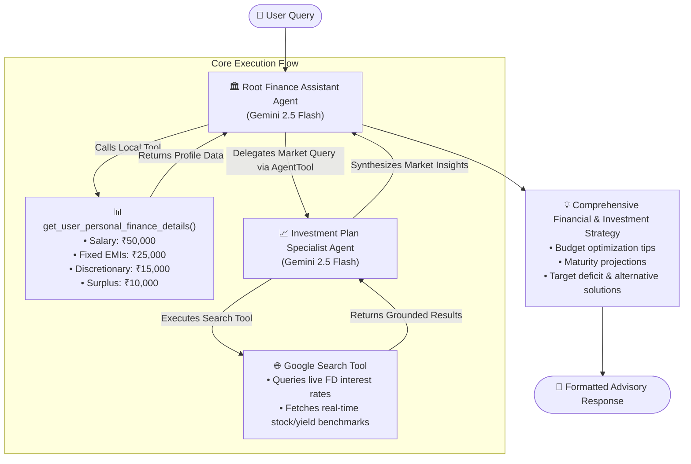

# 🏦 Autonomous AI Finance & Investment Advisory Agent

[](https://python.org)
[](https://google.github.io/adk/)
[](https://ai.google.dev/)
[](#-system-architecture)
[](#-license)

> **Architected and Engineered by [Soma Sriman](https://github.com/somasriman07)**  
> An autonomous multi-agent financial advisory platform built with **Google Agent Development Kit (ADK)** and powered by **Google Gemini 2.5 Flash**. The system synthesizes personal budget metrics with real-time financial market intelligence to provide grounded, data-driven savings and investment advice.

---

## 📌 Executive Summary

Traditional financial planning tools either rely on static spreadsheet formulas with zero intelligence or generative AI models prone to hallucinations and outdated data.

I designed and built the **ADK Finance Assistance Agent** to bridge this gap. By utilizing a **hierarchical multi-agent architecture**, the system decouples personal financial profiling from real-time web intelligence. A primary financial orchestrator evaluates cash flow, fixed obligations (EMIs), and discretionary expenses, while delegating live market research (such as current bank Fixed Deposit rates, inflation benchmarks, and stock quotes) to a dedicated research agent equipped with live search tools.

---

## 🚀 Key Capabilities & Highlights

- **Hierarchical Multi-Agent Coordination**: Developed using Google ADK's `AgentTool` protocol to enable parent-to-subagent delegation with clean separation of concerns.
- **Dynamic Personal Financial Health Assessment**: Native tool integration retrieves granular user income, debt/EMI commitments, and variable spending categories to calculate exact surplus liquidity.
- **Grounded Real-Time Market Intelligence**: Equipped with real-time Google Search integration to verify live interest rates (e.g., SBI/HDFC FD tenures), stock metrics, and market conditions without hallucinating financial figures.
- **Investment Goal Feasibility & Gap Analysis**: Automatically computes compounding projections against user savings targets, identifying realistic deficits and proposing actionable expense restructuring.
- **Interactive Web & CLI Interface**: Seamless deployment and interactive conversational sessions via the ADK Web interface and command-line execution runners.

---

## 🏗️ System Architecture

The project implements a modular, two-tier agent pattern:



### Architectural Breakdown

| Component | Role | Tools / Models | Implementation |
| :--- | :--- | :--- | :--- |
| **Finance Assistant Agent** *(Root)* | Master orchestrator, user interaction, budget assessment, expense triage | `gemini-2.5-flash`, `get_user_personal_finance_details`, `AgentTool(investment_plan_agent)` | [`finance_assistant_agent/agent.py`](finance_assistant_agent/agent.py) |
| **Investment Plan Agent** *(Sub-Agent)* | Specialized financial research agent for public market queries & yield discovery | `gemini-2.5-flash`, `google_search` | [`investment_plan_agent/agent.py`](investment_plan_agent/agent.py) |
| **Profiling Engine** *(Tool)* | In-memory/database mock client retrieving structured income, fixed debt, and spending metrics | Python function with strict type hinting | `get_user_personal_finance_details()` |

---

## 📂 Project Structure

```
ADK_Finance_Assistance_Agent/
├── finance_assistant_agent/            # Root Orchestrator Package
│   ├── __init__.py                     # Package initialization
│   └── agent.py                        # Primary agent logic, tools, and root definition
│
├── investment_plan_agent/              # Specialized Sub-Agent Package
│   ├── __Init__.py                     # Sub-agent package initialization
│   └── agent.py                        # Investment agent with Google Search capabilities
│
├── requirements.txt                    # Project dependencies (google-adk, python-dotenv)
├── .env                                # Local environment variables (API keys - gitignored)
└── README.md                           # Comprehensive documentation & architecture guide
```

---

## 🛠️ Tech Stack & Engineering Specifications

- **Language**: Python 3.10+
- **Agent Framework**: [Google Agent Development Kit (ADK)](https://google.github.io/adk/)
- **Foundation Model**: Google Gemini 2.5 Flash (`gemini-2.5-flash`)
- **Tools & Grounding**: Google Search Tool (`google.adk.tools.google_search`), Custom typed Python tools
- **Environment Management**: `python-dotenv`, Python `venv`

---

## ⚙️ Installation & Setup

### 1. Clone & Navigate to the Repository

```bash
git clone https://github.com/somasriman07/ADK_Finance_Assistance_Agent.git
cd ADK_Finance_Assistance_Agent
```

### 2. Configure Virtual Environment

#### macOS / Linux:
```bash
python3 -m venv venv
source venv/bin/activate
```

#### Windows:
```bash
python -m venv venv
venv\Scripts\activate
```

### 3. Install Dependencies

```bash
pip install -r requirements.txt
```

### 4. Configure Google Gemini API Key

Create a `.env` file in the project root directory:

```env
GOOGLE_API_KEY=your_gemini_api_key_here
```

> [!NOTE]
> You can acquire an API key directly from [Google AI Studio](https://aistudio.google.com/app/apikey).

---

## 💻 Running the Agent

### Mode 1: Interactive Web Studio (Recommended)

Google ADK provides an interactive visual playground to observe agent reasoning, tool invocations, and multi-agent message routing:

```bash
adk web
```

Open your browser at `http://localhost:8000` to interact with the system.

### Mode 2: Terminal CLI Mode

For headless testing or quick CLI dialogues:

```bash
adk run
```

---

## 🧪 Real-World Execution Walkthrough

Here is a live simulation illustrating how the multi-agent system handles complex queries requiring both private profiling and public market grounding:

### User Query:
> *"Can you analyze my financial details, suggest how to save ₹15,000 per month, check current SBI Fixed Deposit interest rates, and tell me if investing ₹15,000 monthly in an FD will yield ₹10,00,000 in 3 years?"*

### Agent Workflow Trace:
1. **Tool Invocation**: Root agent calls `get_user_personal_finance_details()`:
   - Monthly Salary: ₹50,000
   - Fixed Obligations (EMI): ₹25,000
   - Essentials: ₹5,000 | Entertainment: ₹5,000 | Shopping/Travel: ₹5,000
   - Current Surplus: ₹10,000
2. **Sub-Agent Delegation**: Root agent identifies the external market requirement and routes the inquiry to `investment_plan_agent`.
3. **Web Search Grounding**: `investment_plan_agent` triggers `google_search` for *"latest SBI Fixed Deposit 3 year interest rates"*.
4. **Calculations & Gap Analysis**:
   - Compounding formula applied to monthly deposits of ₹15,000 over 36 months at ~6.8%–7.0% APR.
   - Maturity total evaluated (~₹6.05 Lakhs) vs. Target goal (₹10 Lakhs).
5. **Synthesized Strategic Response**:

```markdown
### 📊 Financial Health & Budget Restructuring
- **Monthly Income**: ₹50,000 | **Current Surplus**: ₹10,000 (Target: ₹15,000)
- **Deficit to Target Savings**: ₹5,000 / month
- **Recommended Adjustments**:
  1. Reduce Entertainment budget: ₹5,000 → ₹3,000 (saves ₹2,000)
  2. Optimize Shopping & Travel: ₹5,000 → ₹3,000 (saves ₹2,000)
  3. Streamline Essentials / Utilities: ₹5,000 → ₹4,000 (saves ₹1,000)
  → Total Monthly Savings Reached: ₹15,000

---

### 🌐 Market Intelligence: SBI FD Rates (Verified)
- **Tenure (3 Years)**: 6.50% - 7.00% p.a.
- **Senior Citizens**: 7.00% - 7.50% p.a.

---

### 📈 Goal Feasibility Assessment (3-Year Horizon)
- **Monthly Contribution**: ₹15,000
- **Principal Invested (36 mos)**: ₹5,40,000
- **Estimated Accrued Interest**: ~₹60,000 – ₹70,000
- **Estimated Maturity Value**: ~₹6,05,000
- **Target Shortfall**: You are ₹3,95,000 short of your ₹10,00,000 goal.

### 💡 Strategic Recommendations to Close the Gap
1. **Increase Capital Allocation**: Raise monthly contribution to ~₹24,500.
2. **Asset Allocation / Diversification**: Allocate a portion toward diversified index/equity mutual funds (historical 11–13% CAGR) rather than fixed-income alone.
3. **Horizon Adjustment**: Extend tenure to ~5 years to harness compounding.
```

---

## 🎯 Engineering Challenges & Design Choices

1. **Deterministic vs. Agentic Routing**:
   Instead of hardcoding deterministic rule trees, the orchestration layer relies on ADK's `AgentTool` abstraction. The root agent assesses intent dynamically and delegates to the investment sub-agent only when web research or market calculations are needed.

2. **Preventing Hallucinations on Financial Rates**:
   Interest rates and stock indices change constantly. Hardcoding knowledge within system prompts causes stale data. Prompt engineering within `investment_plan_agent` strictly enforces the search tool whenever keywords like `"current"`, `"latest"`, or specific institutions (e.g. SBI) are detected.

3. **Separation of Concerns**:
   Keeping private user profiling logic strictly inside the root agent's purview protects user credentials/data from being passed indiscriminately to external search queries.

---

## 🗺️ Roadmap & Planned Enhancements

- [ ] **RAG over Bank Statements**: Ingest PDF bank statements and credit card bills using Vector Databases (Chroma/Pinecone) to auto-categorize real spending.
- [ ] **Direct Broker/Banking APIs**: Integrate sandbox banking APIs (Plaid / Setu / Account Aggregator) for live balance syncing.
- [ ] **Interactive Visual Dashboards**: Generate inline interactive charts and visual graphs for wealth projection.
- [ ] **Multi-User Secure Authentication**: Implement JWT/OAuth authentication with encrypted PostgreSQL storage for persistent user profiles.

---

## 📺 Project Walkthrough & Video Demo

- **Video Walkthrough**: [Watch the Full Multi-Agent System Demo on YouTube](https://youtu.be/OA6y5JoEjGs)

---

## 👨‍💻 Author & Developer

**Soma Sriman**  
- **GitHub**: [@somasriman07](https://github.com/somasriman07)  
- **Email**: [somasriman3@gmail.com](mailto:somasriman3@gmail.com)  
- **Focus**: Artificial Intelligence, Agentic Workflows, Multi-Agent Systems & Advanced RAG  

---

## 📄 License

This project is released under the [MIT License](LICENSE). Built for portfolio demonstration and intelligent agent architecture research.
